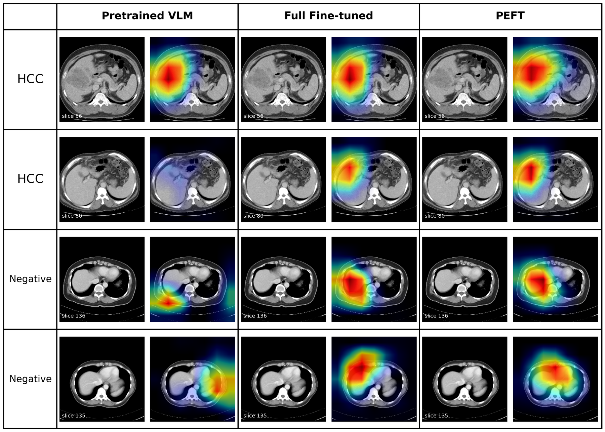
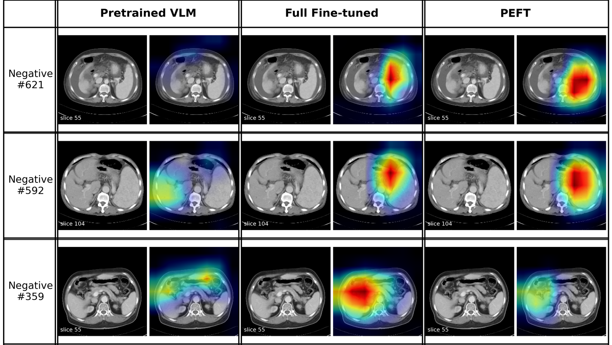
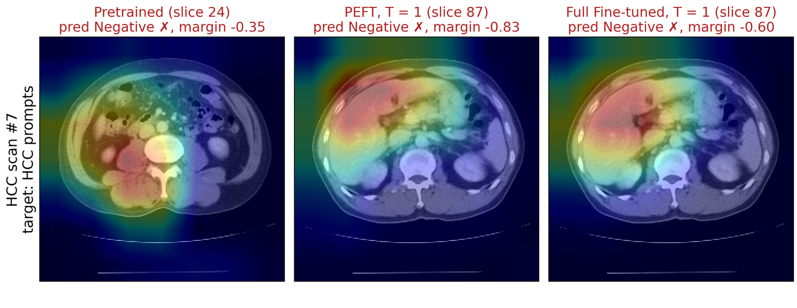
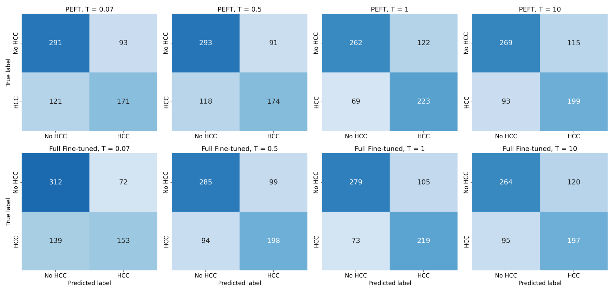
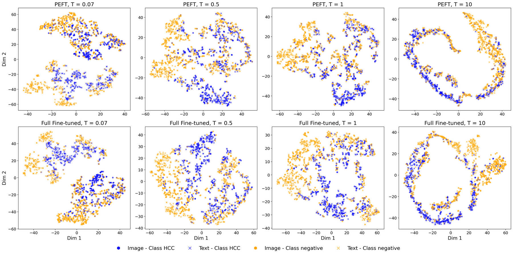
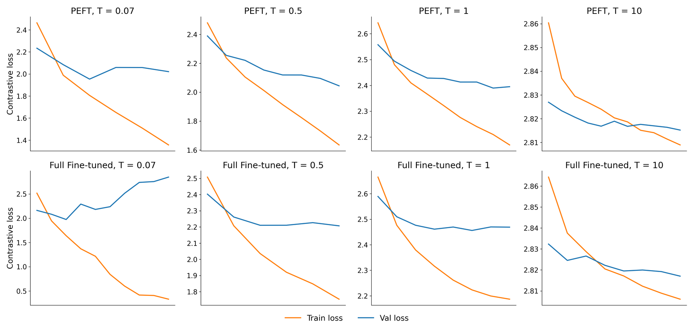

# [Efficient Self-Supervised Adaptation of 3D Abdominal Vision-Language Model for Institution-Specific HCC Classification via Full Fine-Tuning and PEFT](https://arxiv.org/abs/2611.22504)

Official implementation of the paper, published at MIDL 2026 ([PMLR 315:3245-3269](https://proceedings.mlr.press/v315/kartika26a.html)).

> **Note on results.** After publication we found a shortcut in the original preprocessing: volumes were zero-padded along the slice axis, and HCC and negative scans differ in slice count, so the model could separate the classes by padding instead of liver findings. This repository and the [arXiv revision](https://arxiv.org/abs/2611.22504) use the corrected pipeline, which crops to a region that keeps the whole liver and interpolates every volume to 160 slices. HCC classification performance is lower than in the MIDL version. The main findings still hold: temperature initialisation affects adaptation, and PEFT retains external-task (VerSe) performance better than full fine-tuning.

We adapt [Merlin](https://github.com/StanfordMIMI/Merlin), a 3D CT vision-language foundation model, to hepatocellular carcinoma (HCC) classification on portal-venous abdominal CT from a different institution than its pretraining data. Adaptation uses only paired CT volumes and radiology reports, with no lesion annotation or segmentation.

The model is trained with image-report contrastive learning, either by full fine-tuning or by parameter-efficient fine-tuning (PEFT: ConvLoRA on the image encoder and LoRA on the text encoder). HCC is then detected without a classification head, by comparing a scan's embedding against positive and negative text prompts.

## Findings in figures

The Grad-CAM cases below are illustrative examples chosen after looking at candidates, not a random sample. Each map is normalised to its own maximum, so colours show where a model looks, not how strongly.

### Where adaptation helps

<p align="center"></p>

Grad-CAM on a shared slice for the pretrained model, full fine-tuning and PEFT (T = 1, lowest-validation-loss checkpoints).

| Row | Pretrained | Full fine-tuned | PEFT |
|---|---|---|---|
| HCC, large right-lobe mass | Correct, on the tumour | Correct, on the tumour | Correct, on the tumour |
| HCC | Wrong, almost no response on the liver | Correct, right lobe | Correct, right lobe |
| Negative | Wrong, posterior and off the liver | Correct, right liver lobe | Correct, right liver lobe |
| Negative | Wrong, lateral and off the liver | Correct, liver | Correct, liver |

- **Adaptation mostly fixes alignment, not attention.** Across the HCC scans we inspected, the pretrained model often already looks at the liver or the tumour and still predicts wrongly. Fine-tuning raises the image-text margin far more than it moves the focus.
- **The maps are coarse.** The last-layer grid is 7 x 7 per slice, so a liver-centred blob covers most tumours. Without lesion masks these maps show which region matters, not that the decision rests on the tumour itself.

### False positives on cirrhosis

<p align="center"></p>

Three negative scans that all three models call HCC.

- **Top two rows:** both reports describe cirrhosis with splenomegaly and portal hypertension, and no HCC. The adapted models put their attention on the enlarged spleen, not the liver. They have linked the signs that usually accompany HCC with HCC itself.
- **Bottom row:** a negative scan with a 4.5 cm retroperitoneal mass, also called HCC.

This fits the error pattern in the confusion matrices below, where false positives are the main error.

### A missed HCC

<p align="center"></p>

An HCC scan that every model calls negative. The adapted models do look at the right liver lobe, but find nothing there that matches the HCC prompts. The report describes a fatty liver and a 35 mm nodule with arterial enhancement and washout. On venous-phase CT the nodule is low attenuation, and so is the fatty liver around it, and the arterial enhancement that marks it as HCC is not in the input.

The two failure figures come from an earlier analysis with the best-validation-F1 checkpoints.

### Error counts

<p align="center"></p>

Zero-shot confusion matrices on the test split (292 HCC, 384 negative) for each method and initial temperature, using the lowest-validation-loss checkpoints.

- **False positives are the main error at T = 1:** PEFT flags 122 of 384 negative scans as HCC and misses 69 of 292 HCC scans; full fine-tuning flags 105 and misses 73.
- **Low temperature misses more cancers:** at T = 0.07, PEFT misses 121 HCC scans and full fine-tuning misses 139, in exchange for fewer false positives.

### Effect of temperature on the embedding space

<p align="center"></p>

t-SNE of test image embeddings (dots) and report embeddings (crosses). At T = 0.07, images and reports form two separate groups for both methods. At higher temperatures the two modalities overlap and points organise more by class.

### Training behaviour

<p align="center"></p>

Train and validation contrastive loss. At T = 0.07 the validation loss turns upward within a few epochs while the training loss keeps falling, most sharply for full fine-tuning. At higher temperatures the gap opens more slowly.

## Setup

Create the conda environment (Python 3.9, PyTorch 2.6 with CUDA 12.4):

```bash
conda env create -f environment.yml
```

```bash
conda activate hcc-merlin
```

For a different CUDA version, change the PyTorch index URL in `environment.yml`. The experiments were run on a single NVIDIA RTX A6000 (48 GB).

The pretrained Merlin weights are downloaded from the [Hugging Face Hub](https://huggingface.co/stanfordmimi/Merlin) into `merlin/models/checkpoints/` the first time a model is built.

## Data

The dataset and trained checkpoints are not included in this repository. Training expects a CSV with one row per study and these columns:

| Column | Meaning |
|---|---|
| `imagedir` | Study folder name, looked up under the negative root first and then the image root |
| `patho` | `HCC`, or empty / `negative` for a negative study |
| `Content` | Full report text |
| `Anatomies` | Anatomy-level report text |
| `venous_phase` | Non-zero if the study has a venous-phase series |
| `split` | `train`, `val` or `test` |

Volumes are NIfTI files (`.nii.gz`). With `--phase venous`, the loader picks the file whose name contains `venous`.

Each volume is reoriented to RAS, resampled to 1.5 × 1.5 × 3 mm, clipped to [-1000, 1000] HU, interpolated to 160 slices and centre-cropped to 224 × 224 × 160. Preprocessed volumes are cached under `<cache_root>/interpolate_venous_phase_cache`.

## Configuring paths

Paths in this repository are placeholders. Set them before running, either on the command line or by editing the defaults:

- `config.py`: `--dataset_csv`, `--image_root`, `--negative_root`, `--model_save_path`, `--cache_root`
- `train.py`: the VerSe annotation file and CT directory in `build_dataloaders`, and the Weights & Biases `entity`
- `main.sh`, `main_ablation.sh`: `CHECKPOINT_DIR` and `CACHE_ROOT`
- `zero_shot.py`: checkpoint, dataset and cache paths at the top of the file

## Training

A single run:

```bash
python train.py \
    --phase venous \
    --tuning_mode lora \
    --learning_rate 1e-3 \
    --temperature 1.0 \
    --epochs 300 \
    --patience 5 --early_stop_on val_f1 \
    --train_batch_size 18 --val_batch_size 18 \
    --dataset_csv path/to/dataset.csv \
    --image_root path/to/positive_images \
    --negative_root path/to/negative_images \
    --cache_root path/to/cache_root \
    --model_save_path path/to/checkpoints/run.pth \
    --results_json path/to/checkpoints/run_results.json \
    --evaluate
```

The sweeps used for the experiments:

```bash
bash main.sh
```

```bash
bash main_ablation.sh
```

### Tuning modes

| `--tuning_mode` | Trainable parameters |
|---|---|
| `full` | Both encoders |
| `lora` | ConvLoRA on the image encoder, LoRA on the text encoder, both projection layers |
| `lora_text` | LoRA on the text encoder and the text projection |
| `lora_image` | ConvLoRA on the image encoder and the image projection |
| `projection` | Image and text projection layers only |

### Training details

- Symmetric image-text contrastive loss with a learnable temperature, initialised from `--temperature`.
- AdamW with layer-wise learning-rate decay (`--lldr_mult`), linear warmup (`--warmup_epochs`) and cosine decay.
- Mixed precision, with gradients accumulated over 8 batches per optimizer step.
- BatchNorm running statistics in the image encoder are kept fixed during training.
- `--evaluate` runs zero-shot HCC evaluation on the validation split and the VerSe fracture check after every epoch.
- `--patience` enables early stopping on the metric chosen by `--early_stop_on` (`val_loss` or `val_f1`).
- `--use_wandb` logs to Weights & Biases.

### Outputs

For `--model_save_path run.pth`, training writes:

| File | Content |
|---|---|
| `run_best_loss.pth` | Checkpoint with the lowest validation contrastive loss |
| `run_best_f1.pth` | Checkpoint with the highest zero-shot validation F1 (needs `--evaluate`) |
| `*_merged.pth` | The same checkpoints with LoRA weights merged into the base model (LoRA modes) |
| `--results_json` file | Hyperparameters, best epochs and zero-shot test metrics for each checkpoint |

## Zero-shot evaluation

To evaluate a saved checkpoint on the test split, set the paths at the top of `zero_shot.py` and run:

```bash
python zero_shot.py
```

Use a merged checkpoint for LoRA runs, since the script builds the plain Merlin model.

The prompts are defined in `config.py` (`HCC_PROMPTS`, `FRACTURE_PROMPTS`). A scan is predicted positive when its mean similarity to the positive prompts is higher than its mean similarity to the negative prompts.

## Acknowledgements

This work builds on [Merlin](https://github.com/StanfordMIMI/Merlin) by the Stanford Machine Intelligence for Medical Imaging (MIMI) lab, released under the MIT License. The fracture check uses the [VerSe](https://github.com/anjany/verse) dataset.
